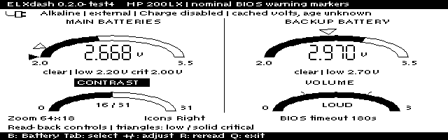

# ELKS-scrcap

[Download 0.2.0](https://github.com/l00nix/ELKS-scrcap/releases/tag/v0.2.0) · [Integration status](integration/README.md)

A screen-capture utility for [ELKS](https://github.com/ghaerr/elks) on 8086/8088-based
PCs. The project targets multiple display adapters and resolutions, with the
HP 200LX as one supported platform. The executable remains **`scrcap`**
(formerly `elxcap` / ELXcap), preserving 8.3-compatible installed names.

**Release 0.2.0 currently captures 640×200 monochrome images only**, through the
backends below. It saves 1-bit BMP or binary PBM without changing the display mode.
This is the current implementation limit, not the intended scope of the project.
See the [display support plan and GEMCAP comparison](docs/DISPLAYS.md).

## Screenshot



ELXdash 0.2.0-test4 on the single-speed HP 200LX, saved by ELXcap
and retrieved on 19 October 2026. This shows the capture output;
scrcap itself is a command-line utility.
The original 640×200 pixels are preserved. The displayed names and versions predate
the standalone rename. [Original BMP](docs/images/dash.bmp) ·
[Capture details](docs/images/README.md).

## Currently supported displays (0.2.0)

| Backend | Support |
| --- | --- |
| `auto` (default) | Detect HP 200LX firmware; otherwise use the CGA backend |
| `cga` | IBM-compatible CGA mode 6, 640x200, page 0 |
| `hp` | HP 200LX mode 6 and 80x25 text modes 2/3 using the machine's ROM font |

The generic CGA path does not require an HP ROM or an HP kernel. It is fixture-tested;
other physical ELKS machines still need validation. Generic PC text, MDA, Hercules,
other VGA/EGA modes and PC-98 are not implemented. Unsupported modes/pages are rejected.
The tool reads `/dev/kmem` (normally as root) and captures the physical console,
not a serial terminal. Hardware cursor, LCD zoom and LCD inversion are not reproduced.
HP ROM data is read on the device and is not distributed with this project.

## Use

```sh
scrcap /root/screen.bmp
scrcap -f pbm /root/screen.pbm
scrcap --backend cga -d 15 /root/screen.bmp
scrcap -q -d 15 >/tmp/cap.log 2>&1 &
```

With no filename, files are numbered `CAP0000.BMP`, `CAP0001.BMP`, and so on.
Existing files are never overwritten. `-i` inverts the exported pixels; `-f pbm`
selects PBM (the suffix alone does not select a format). Both formats preserve the
same pixels; BMP is convenient for desktop viewers.

For repeated captures without a kernel patch:

```sh
scrcap --watch /root >/tmp/cap.log 2>&1 &
# Send SIGUSR1 to that process for each capture; SIGTERM stops it.
```

`--image FILE` is for offline test fixtures, not live hardware.

### Optional Alt + . hotkey and the kernel patch

**Ordinary, delayed and SIGUSR1-triggered captures do not need this patch.**
It is only needed for `scrcap --hotkey /root`, the optional **HP-only** background
listener that captures when Alt + . is pressed while another application is active.

The [legacy hotkey integration](kernel/) adds a keyboard hook and a small event
interface in the kernel. The hook records the shortcut; the background scrcap
process reads the event and performs the capture and file write. No screenshot
or filesystem work runs inside the keyboard interrupt. A renewable three-second
lease stops an abandoned listener from permanently reserving the shortcut.

Using it requires integrating the patch into a compatible HP firmware-aware ELKS
source tree, rebuilding the kernel and booting that kernel. Installing scrcap alone
cannot add this keyboard support. The build and install scripts do not apply the
patch, and the retained legacy code has not been validated against current upstream
kernels. An unsupported kernel reports “kernel patch required”; use `-d` or
`--watch` instead. This patch is separate from the external-application build patch
and does not change the BMP/PBM output formats.

## Build and install

Use a configured [ELKS source tree](https://github.com/ghaerr/elks) with its
IA16 compiler and matching libc installed:

```sh
ELKS=/path/to/elks sh build.sh
make install DESTDIR=/path/to/staging-root
```

The build targets the 8086 and audits the retained ELF, disassembly and near-memory
layout. Output is `build/scrcap`. Install paths are `/bin/scrcap` and
`/lib/scrcap/{copying,usage.txt}`; every installed component fits 8.3 naming.
The staging root must exist on the host; do not point it at an unintended filesystem.

[External build and EPT integration](integration/README.md) includes the package
recipe. Upstream registration and EPT server publication are separate steps;
the recipe alone does not make the package available from the default EPT server.

## Tests and status

```sh
make test
```

Host tests require a C compiler and Python 3. Native builds are additionally checked with `elksemu`; synthetic memory fixtures
are not hardware captures. See [validation](docs/TESTING.md) for this release.

## Origins and license

Developed by [@l00nix](https://github.com/l00nix) with AI assistance, originally as part of the
[HP 200LX ELX suite](https://github.com/l00nix/HP-200LX-elx-suite).
The standalone source starts from suite commit `a2cc3f3`; historical suite releases
retain their original names. ELKS provides the operating system, libc and toolchain.
Project code is [GPL-2.0-or-later](COPYING). Existing attribution is retained.

Inspired by [GEMCAP](https://www.ledudu.com/HPLX/super7.html), Natural Software's
DOS resident screen-capture utility, documented in the preserved S.U.P.E.R. archive
under “Screen Capture.” GEMCAP saved GEM `.IMG` files; ELKS-scrcap uses BMP/PBM.
The hotkey-to-file workflow is the inspiration; no GEMCAP source or binaries are included.
