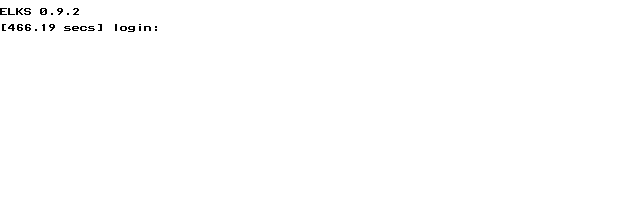

# Screenshot provenance

ELXdash 0.2.0-test4 on the single-speed HP 200LX, saved by ELXcap
and retrieved on 19 October 2026. This shows the capture output;
scrcap itself is a command-line utility.

- `dash.png`: existing lossless PNG viewing conversion, copied without changes.
- `dash.bmp`: original 640×200, 1-bit BMP retrieved from the HP.
- No cropping, resampling, retouching or changes to the displayed application names.
- Transfer checksums were verified against the HP files.
- This is a historical hardware capture, not a claim of hardware validation of the
  renamed 0.2.0 standalone binary.

Original BMP SHA-256: `7eff770ea0fe0b27eb855ef46136f534e7e9e5d480dcd4c430b70bc76ea22913`.

The files were retained from the HP 200LX project hardware test records for
19 October 2026. They contain the original tool output, not synthetic/demo data.

## PPC text capture, 0.5.0

`ppctext.bmp` is the physical Amstrad PPC text console captured by the final
scrcap 0.5.0 binary on 21 November 2026, after the separate Cmdr test session
ended. Command: `/root/sc05/scrcap --backend pc /root/sc05/ppcfin.bmp`.
The file was transferred over FTP; `ppctext.png` is a lossless 640×200 viewing
conversion. No cropping, scaling, font editing or reconstructed text was applied
after capture. scrcap used PC ROM lower glyphs and fallback upper glyphs.

The machine remained responsive over the network. Physical display inspection
is pending because the user was away. A prior overlapping test-page/Cmdr capture
is intentionally excluded from this gallery.

BMP SHA-256: `860828524f947cfabf4f7e85f95529a72146e9c9b919157ccd3045a7406f709c`.

Executable SHA-256:
`43960679832f3cf8b80d7930c34c49bdb24bfb634412205ee18d14dc59d6d0f1`.
